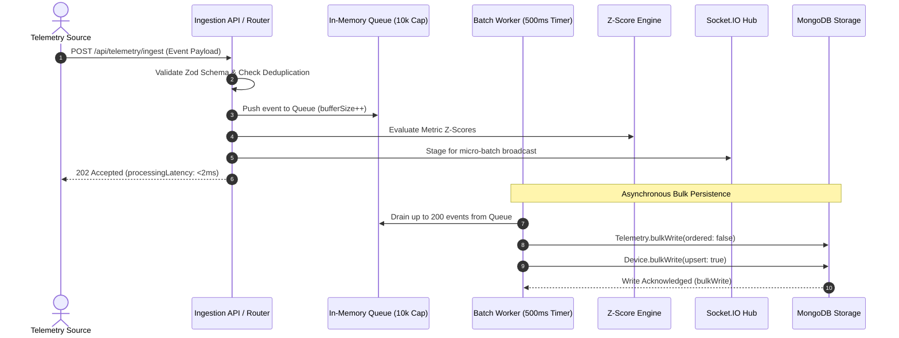

# HyperPulse Architecture & Design Document

> **System Architecture, Data Flow Specifications, and Performance Engineering Guide**  
> MERNIFY Hackathon 2026

---

## 1. System Architecture Diagram

```mermaid
graph TD
    subgraph Data Sources
        DS1[Edge Servers Cluster<br/>CPU, RAM, Latency, Temp]
        DS2[Logistics Fleet<br/>GPS, Speed, Battery, Heading]
        DS3[Energy Turbines<br/>Power MW, Vibration, Oil Temp]
        DS4[External Ingestion CLI<br/>standalone-producer.js]
    end

    subgraph Node.js & Express Ingestion Layer
        API[HTTP REST Endpoints<br/>POST /api/telemetry/ingest<br/>POST /api/telemetry/batch]
        VAL[Zod Schema Validator]
        RL[Sliding Window Rate Limiter]
        DEDUP[In-Memory Event Deduplicator<br/>Bloom Filter / Set]
    end

    subgraph Real-Time Processing Pipeline
        BUFFER[Write-Behind Batch Buffer<br/>Flush: 500ms / 200 events]
        ANOMALY[Statistical Anomaly Engine<br/>Z-Score |Z| >= 3.2 + Thresholds]
        SOCKET_SRV[Socket.IO Broadcast Engine<br/>Micro-batching 80ms window]
    end

    subgraph Database Layer
        MONGO[(MongoDB Database<br/>Compound Indexes)]
        COLL_TEL[Telemetry Collection<br/>deviceId + timestamp]
        COLL_DEV[Device Registry<br/>status, health, lastSeen]
        COLL_ALT[Alerts Collection<br/>severity, metrics, timestamp]
    end

    subgraph Client Application Layer
        CLIENT1[React Client A<br/>Room: global + alerts]
        CLIENT2[React Client B<br/>Room: category:fleet]
        CLIENT3[React Client C<br/>Room: device:srv-us-east-prod]
    end

    DS1 --> API
    DS2 --> API
    DS3 --> API
    DS4 --> API

    API --> VAL --> RL --> DEDUP

    DEDUP --> BUFFER
    DEDUP --> ANOMALY
    DEDUP --> SOCKET_SRV

    BUFFER -->|bulkWrite ordered:false| COLL_TEL
    BUFFER -->|bulkWrite upsert| COLL_DEV
    ANOMALY -->|create alert| COLL_ALT
    ANOMALY -->|alert:new| SOCKET_SRV

    SOCKET_SRV -->|telemetry:batch| CLIENT1
    SOCKET_SRV -->|telemetry:batch| CLIENT2
    SOCKET_SRV -->|telemetry:device_feed| CLIENT3

    COLL_TEL -.->|GET /api/telemetry/history| CLIENT3
```

---

## 2. Ingestion & Write-Behind Processing Pipeline

High-frequency ingestion pipelines frequently fail when direct database writes occur synchronously on the request thread. HyperPulse addresses this with a **Write-Behind Batch Buffer**:



---

## 3. Database Schemas & Indexing Strategy

### 3.1 `Telemetry` Schema
```javascript
{
  eventId: { type: String, required: true, index: true },
  deviceId: { type: String, required: true, index: true },
  category: { type: String, required: true, enum: ['server', 'fleet', 'turbine', 'iot'], index: true },
  timestamp: { type: Date, required: true, index: true },
  sequence: { type: Number, default: 0 },
  metrics: { type: mongoose.Schema.Types.Mixed, required: true },
  status: { type: String, enum: ['healthy', 'warning', 'critical'], default: 'healthy', index: true },
  location: {
    latitude: Number,
    longitude: Number,
    label: String
  }
}
```
**Compound Indexing:**
1. `{ deviceId: 1, timestamp: -1 }`: Optimizes single-device historical lookups and deep-dive charts.
2. `{ category: 1, timestamp: -1 }`: Accelerates category aggregation and filtered queries.
3. `{ timestamp: -1 }`: Powers global time-window queries.

### 3.2 `Device` Schema
Tracks the current state, metadata, and status of every monitored node:
```javascript
{
  deviceId: { type: String, required: true, unique: true },
  name: { type: String, required: true },
  category: { type: String, required: true, enum: ['server', 'fleet', 'turbine', 'iot'] },
  region: { type: String, default: 'Global' },
  status: { type: String, enum: ['online', 'degraded', 'offline', 'warning', 'critical'], default: 'online' },
  healthScore: { type: Number, min: 0, max: 100, default: 100 },
  lastSeen: { type: Date, default: Date.now },
  lastMetrics: { type: mongoose.Schema.Types.Mixed, default: {} },
  lastLocation: { latitude: Number, longitude: Number, label: String },
  tags: [String]
}
```

### 3.3 `Alert` Schema
```javascript
{
  alertId: { type: String, required: true, unique: true },
  deviceId: { type: String, required: true, index: true },
  deviceName: String,
  category: { type: String, required: true },
  severity: { type: String, enum: ['info', 'warning', 'critical'], default: 'warning' },
  title: { type: String, required: true },
  message: { type: String, required: true },
  metric: String,
  triggerValue: Number,
  thresholdValue: Number,
  timestamp: { type: Date, default: Date.now, index: true },
  resolved: { type: Boolean, default: false, index: true },
  resolvedAt: Date,
  resolvedBy: String
}
```
**Compound Index:** `{ severity: 1, resolved: 1, timestamp: -1 }` for instant retrieval of active unresolved alerts.

---

## 4. Real-Time Communication & Optimization Techniques

### 4.1 Selective Room Partitioning
Clients connect via Socket.IO and subscribe exclusively to channels of interest:
- `global`: Receives aggregated system metrics (`metrics:snapshot`) every 1s.
- `category:{server|fleet|turbine}`: Receives domain-filtered batches.
- `device:{deviceId}`: Receives high-resolution sub-second feeds when a user opens that device's inspector.
- `alerts`: Immediate push notifications for anomalous conditions.

### 4.2 Micro-Batching on Server (80ms Window)
Emitting a WebSocket event for every individual packet at 1,000 events/sec incurs high socket framing overhead. HyperPulse buffers outgoing events in an 80ms window (~12 FPS) and transmits them in structured arrays:
```json
[
  { "eventId": "EVT-101", "deviceId": "srv-us-east-prod", "metrics": { "cpuPercent": 78 } },
  { "eventId": "EVT-102", "deviceId": "fleet-ev-01", "metrics": { "speedKmh": 94 } }
]
```

### 4.3 Client-Side Throttled Rendering
On the browser side, incoming packets are queued in a reference array and drained into React state once every 100ms. This decouples socket packet reception from DOM rendering, ensuring smooth 60 FPS animation without lockups or frame stutter.

### 4.4 Statistical Z-Score Anomaly Detection
An online sliding window of the last 30 readings calculates rolling mean ($\mu$) and standard deviation ($\sigma$):
$$\mu = \frac{1}{N}\sum_{i=1}^{N} x_i, \quad \sigma = \sqrt{\frac{1}{N}\sum_{i=1}^{N}(x_i - \mu)^2}$$
$$Z = \frac{x_{current} - \mu}{\sigma}$$
If $|Z| \ge 3.2$, the event is classified as an outlier and dispatched as an incident alert. An anti-flap cooldown window (20 seconds) prevents redundant alerts from flooding the notification bus.
