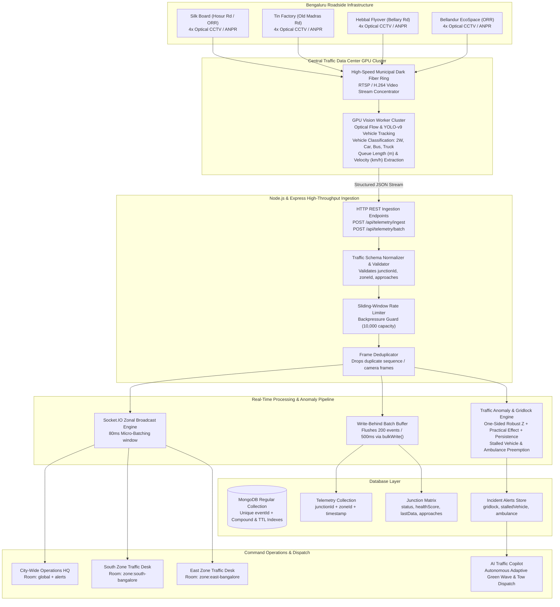

# MetroPulse BLR: Smart City Traffic Architecture & Design Document

> **Centralized Camera Telemetry Ingestion, Gridlock Detection & Adaptive Signal Control**  
> MERNIFY Hackathon 2026 • Track: High-Throughput Streams & Telemetry

---

## 1. System Architecture Diagram

---

## 2. Core Architectural Decisions

### A. Centralized Data Center Processing vs. Edge Junction Compute
- **The Challenge:** Roadside controller cabinets on Bangalore roads endure extreme humidity, monsoonal flooding, 40°C summer dust, and unstable grid power. Deploying high-power GPU accelerators on every junction pole would incur catastrophic failure rates and enormous replacement costs.
- **The Solution:** Roadside cameras act purely as ruggedized RTSP optical emitters streaming video over municipal fiber to the **Centralized City Data Center**. Scalable GPU vision clusters perform object detection, optical flow queue calculation, and vehicle classification in an air-conditioned, redundant environment, emitting structured JSON telemetry into the ingestion pipeline.

### B. Strategic Scope: Traffic Only (Air Quality Omitted)
- **The Choice:** Air quality and noise monitoring were considered during planning and left out.
- **The Reason:** Focus. With limited time we chose to solve one problem completely (traffic ingestion, live selective broadcasting, gridlock detection and the ambulance green corridor) rather than cover two domains thinly. It was not a compute decision: air sensor data would be far smaller than traffic data.

### Sampling Strategy & Span Links vs. Parent-Child
- **Head Sampling (`OperatorAwareSampler`):** Uses `ParentBased(TraceIdRatioBased(OTEL_SAMPLE_RATIO || 0.05))` for high-volume telemetry endpoints so steady-state tracing adds low overhead, while always sampling operator actions and control-plane endpoints (`copilot.whatif`, `operator.action`, `/api/sim/controller`, `/api/sim/scenario`, `/api/copilot/*`, `/api/alerts/*/resolve`).
- **Span Links Across Async Batching:** Within a single ingest request, `telemetry.ingest -> telemetry.validate -> buffer.enqueue` form a strict parent-child hierarchy. Because `buffer.flush` writes a micro-batch of up to `500` events accumulated from many independent requests (or simulator ticks), `buffer.flush` starts in `ROOT_CONTEXT` and attaches OTel **span links** (up to 64 unique sampled `SpanContext`s per flush) pointing back to all sampled `telemetry.ingest` / `buffer.enqueue` spans persisted in that batch.
- **Physics Step Cost (`sim_step_ms`):** `sim.step` executes every simulation second and is intentionally recorded via the `sim_step_ms` histogram rather than creating per-step spans.

### Explicit Histogram Bucket Boundaries & Percentile Interpolation
Every OTel histogram uses an explicit `AggregationType.EXPLICIT_BUCKET_HISTOGRAM` SDK view so percentiles are derived directly from cumulative bucket counts:
- Latency histograms (`ingest_to_persist_ms`, `ingest_to_emit_ms`, `flush_duration_ms`, `sim_step_ms`, `client_e2e_ms`): `[0.5, 1, 2, 5, 10, 20, 50, 100, 200, 500, 1000, 2500, 5000]` ms.
- `flush_batch_size`: `[1, 5, 10, 25, 50, 100, 250, 500, 1000, 2500]` events.
- `socket_frame_bytes`: `[128, 256, 512, 1024, 2048, 4096, 8192, 16384, 32768, 65536]` bytes.

Reported `p50`, `p95`, and `p99` values use **linear interpolation inside the target bucket** (`lower + ((rank - prevCum) / bucketCount) * (upper - lower)`, bounded by `[max(0, min), max]` on edge buckets). Because raw observations within a bucket are not retained, interpolated percentiles are an estimate bounded by bucket width rather than exact sample quantiles.

### Honest Client End-to-End Latency (`client_e2e_ms`) & NTP Clock-Offset Correction
Measuring true `server emit -> client render` latency across separate machines cannot assume synchronized wall clocks:
1. Clients send `telemetry:ping` (`t0`), and the server replies on `telemetry:pong` with `serverRecvTimestamp` (`t1`) and `serverSendTimestamp` (`t2`), received by the client at `t3`.
2. The client estimates clock offset $\theta = \frac{(t_1 - t_0) + (t_2 - t_3)}{2}$ using a rolling median of the 7 most recent pongs to reject transient jitter.
3. Each outbound Wire v1 frame carries server emit epoch `et`. After `hotStore.applyBatch(...)` commits to React's external store, a `requestAnimationFrame` callback captures post-paint timestamp `t_render` and computes `e2eMs = max(0, t_render - (et - offset))`.
4. Every 5 seconds, `SocketContext` emits bounded samples and summary percentiles on `client:latency`, which the server records into the `client_e2e_ms{room}` OTel histogram.

---

## 8. Traffic Physics Self-Consistency, Calibration & Controlled Study

### Exact Approach Saturation ($v/c$) & Segment Speed Derivation
All approach-level speed, delay, and status indicators derive from unified corridor physics over a fixed approach control segment of length $L_{\text{seg}} = 400\text{ m}$ (`APPROACH_SEGMENT_LENGTH_M` in `server/src/sim/network.js`) with free-flow speed $v_{\text{free}} = 40\text{ km/h}$ (`FREE_FLOW_SPEED_KMPH`) and jam crawl floor $v_{\min} = 3\text{ km/h}$ (`MIN_SPEED_KMPH`):

$$v/c = \frac{\lambda_i}{S_i \cdot \text{incidentFactor}_i \cdot \text{weatherCap} \cdot g_{\text{eff},i}}$$

- **Arrival rate ($\lambda_i$)**: Rolling 60-second exogenous + upstream platoon arrival count divided by 60 s (`rollingSum / 60`).
- **Realised effective green ratio ($g_{\text{eff},i}$)**: Taken from `RealisedTimingTracker.getSummary().alignedGreenSharePct[i] / 100` (falling back to rolling `greenSharePct` over the 300 s window when an acyclic controller skips a phase, or planned `split / cycle` during the first 20 s warmup; aligns to full all-phase rotations when cyclic to eliminate partial-cycle aliasing). Clamped to $[0.05, 0.90]$.
- **Segment travel-time speed ($v_i$)**: Estimates per-vehicle control and overflow delay on top of $400\text{ m}$ free-flow traversal time ($t_{\text{free}} = 400 / (40 / 3.6) = 36\text{ s}$):
  - **HCM uniform red delay**: $d_1 = 0.5 \cdot C \cdot \frac{(1 - g_{\text{eff},i})^2}{1 - \min(0.95, v/c \cdot g_{\text{eff},i})}$
  - **BPR overflow penalty**: $d_2 = 0.35 \cdot C \cdot (\max(0, v/c - 0.85))^{1.8}$
  - **Little's Law queue wait**: $Q_i / \max(0.05, \text{effCap}_i)$ (weighted when $\lambda_i$ is low so lingering queues clear accurately)
  - Resulting segment speed $v_i = \max(3, \min(\frac{400}{(t_{\text{free}} + d_{\text{ctrl}}) / 3.6}, v_{\text{storage}}))$ is bounded above by both segment traversal speed and storage-collapse Greenshields speed, so $v/c \ge 1.0$ or growing queues cannot coexist with contradictory free-flow speeds.

### Multi-Factor Status Classification
Both backend telemetry normalization (`classifyTrafficStatus` in `server/src/sim/network.js`) and UI classification (`classifyJunctionStatus` in `client/src/utils/semantics.jsx`) enforce consistent saturation thresholds:
1. **`critical`** (`Incident` / `Emergency`): Active stalled vehicle or emergency responder preemption.
2. **`gridlock`** (`Gridlock`): $\text{maxQueueM} > 180$, $\text{avgSpeedKmph} < 10$, $\text{avgDelaySec} \ge 65$, or severe sustained overload ($v/c \ge 2.0$ with $\text{maxQueueM} \ge 60$).
3. **`congested`** (`Heavy`): $\text{maxQueueM} > 120$, $\text{avgSpeedKmph} < 15$, $v/c \ge 1.0$, or $\text{avgDelaySec} \ge 35$. Sustaining $v/c \ge 1.0$ can never classify as `healthy` (`Flow`).
4. **`warning`** (`Heavy`): $\text{maxQueueM} > 85$, $\text{avgSpeedKmph} < 20$, $v/c \ge 0.85$, or $\text{avgDelaySec} \ge 22$.
5. **`healthy`** (`Flow`): Otherwise.

### Honest PM-Peak Calibration & Empirical Benchmark Findings
- **External Reference Calibration**: TomTom's Bengaluru Traffic Index reports citywide average speeds near **16.6 km/h** overall and **13.9 km/h** during peak rush hours (~13.2 km/h evening peak). Under the calibrated `pm-peak` preset (`18:30 IST`, effective `0.30x` network scale = `BASE_DEMAND_SCALE 0.25 * 1.20`), MetroPulse BLR produces a network arterial mean speed starting near **17.8 km/h** (14–21 km/h across the 12 corridors) and settling around **~16.5 km/h** over sustained peak flow.
- **Controlled Empirical Study (`npm run study` — 1,200 CRN Episodes, 30 Cells × 10 Seeds × 1800 s)**:
  - **Moderate / Undersaturated & Disrupted Regimes**: Normalized capacity-aware Max-Pressure (`max-pressure-ca`) achieves statistically significant delay reductions vs offline `fixed-tod` in **11/15** stationary cells (up to `-11.1%` at `am-peak @ 0.25`, `-3.3%` at `pm-peak @ 0.25`) and **11/15** disrupted `surge_incident` cells (up to `-45.6%` delay). EWMA `webster` wins **2/15** heavy-AM stationary cells (up to `-8.0%`) and **12/15** disrupted cells under asymmetric surges.
  - **Stationary Heavy PM-Peak Saturation (`0.30–0.35`)**: Offline Webster-tuned `fixed-tod` retains the lowest delay (`70.84 s/veh` at `pm-peak @ 0.35`), beating raw Max-Pressure (`133.82 s/veh`, `+88.9%`) and `max-pressure-ca` (`105.86 s/veh`, `+49.4%`) because long 150 s cycles avoid 4 s intergreen switch losses when all phases remain near capacity. The live counterfactual badge (`Delay vs baseline: +x%` / `-x%`) reports both wins and losses honestly against the paired fixed-time shadow baseline.
